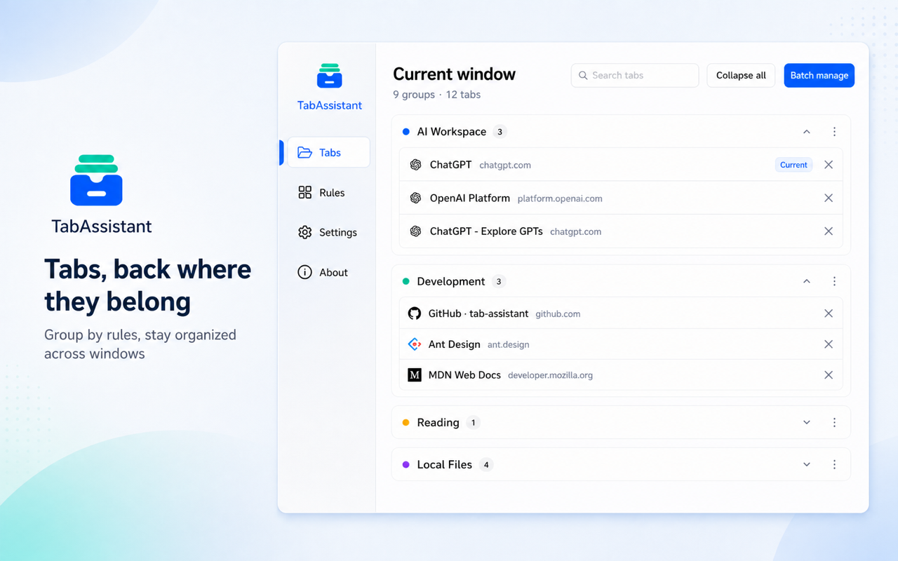
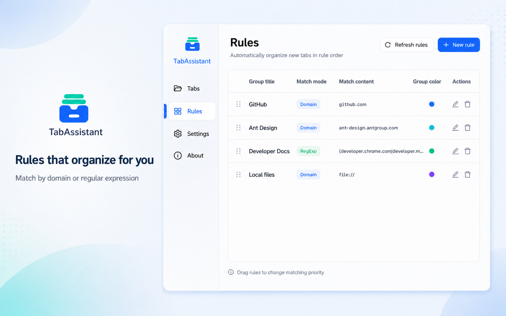
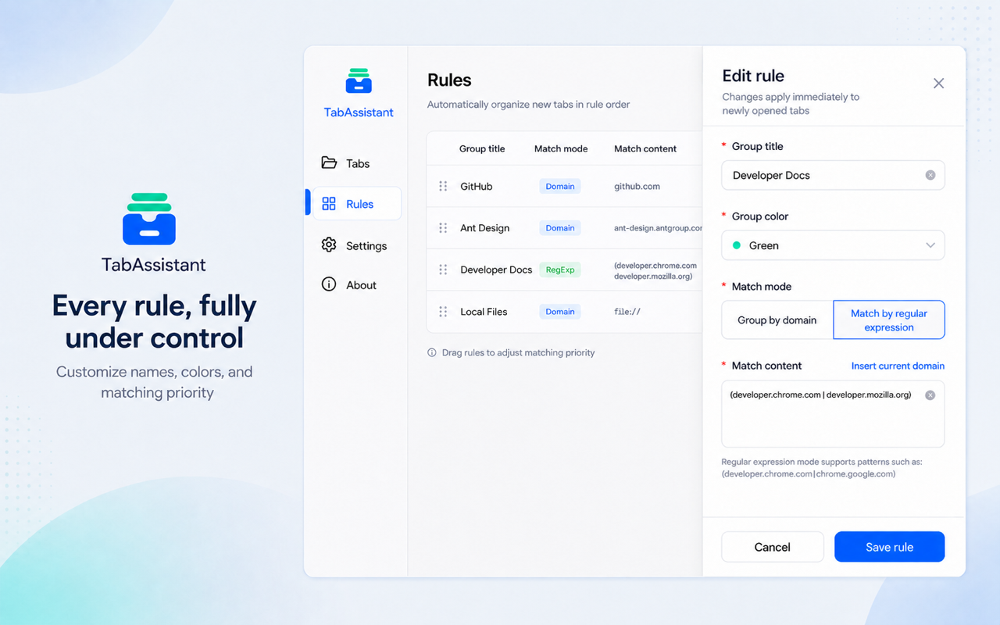

<p align="right">
  English · <a href="./README.zh-CN.md">简体中文</a>
</p>

<div align="center">
  
  <h1>TabAssistant</h1>
  <p>Bring browser tabs back into order</p>
  <p>
    Rule-based auto-grouping · Independent multi-window management · Runs locally
  </p>
  <p>
    <a href="https://chromewebstore.google.com/detail/obdaljfdjocbdmpofhncldmfppjeemda">Install for Chrome / Edge</a>
    ·
    <a href="https://github.com/woolson/tab-assistant/issues">Feedback</a>
    ·
    <a href="./LICENSE">MIT License</a>
  </p>
</div>



## Why TabAssistant?

As tabs pile up, finding pages, organizing groups, and switching between windows all become unnecessarily time-consuming.

TabAssistant organizes newly opened tabs according to your rules, automatically placing scattered pages into the right groups. From one interface, you can search, expand, collapse, close, or restore tabs while keeping every browser window independently organized.

Rule-based organization runs locally. Optional AI grouping sends tab titles, URLs, group information, and any enabled page excerpts/click context directly to your selected AI provider, which may charge for API usage. TabAssistant has no relay server. Rules and preferences are stored in browser extension storage and can use your browser's built-in sync capability.

## Features

- **Rule-based auto-grouping**: Match newly opened tabs by domain or regular expression.
- **Clear, flexible rule management**: Customize group names, colors, and matching patterns, then drag rules to change their priority.
- **Batch management for the current window**: Search tabs, expand or collapse all groups, close multiple tabs, and restore accidentally closed pages.
- **Independent multi-window organization**: Manage every window separately and keep tabs in their original browser window.
- **Automatic local-file grouping**: Place `file://` pages into a dedicated Local Files group.
- **Auto-close inactive tabs**: Optionally close web page tabs (http/https/file only) that have not been visited for a configurable amount of time (30 minutes by default; off by default). The countdown restarts every time you revisit a tab, and the tab you are viewing, pinned tabs, tabs playing audio, the last tab in a window, and browser built-in pages (such as the New Tab page) are never closed.
- **Personalized appearance**: Choose a light theme, dark theme, or follow your system setting.
- **Chinese and English UI**: Switch between Simplified Chinese and English.
- **Configuration migration**: Import and export grouping rules and extension preferences.

Decision logging is off by default. Enable **Settings → Logging → Record decision logs** to record AI grouping decisions and show the log page. Disabling it immediately stops recording and hides the page without affecting auto-grouping. Switch changes are saved immediately and persist after reopening. **Clear existing logs** also works while logging is off and does not change the switch. Logs stay on this device.

## AI API setup

Open **Rules** and use the same segmented control as the language setting to choose **Custom mode** or **AI mode**. Custom mode shows your saved rules on a blue background; AI mode shows API settings on a purple background, with matching dark-theme colors. The selected mode is saved immediately without a success notification, and switching preserves your rules and API settings. In AI mode, select DeepSeek, OpenAI, Qwen, Claude or Gemini, enter your API key and save the AI configuration. Provider endpoints and default models are filled automatically. Choose a model from the main settings dropdown; a small note below explains its purpose and whether it is recommended for auto-grouping. Choose **Custom model** to enter another model ID. Updated defaults do not overwrite saved models. **Test connection** sends a small test prompt without browsing data; testing does not save the draft. Expand **Endpoint and timeout settings** to override endpoint defaults or select **Custom** to enter an OpenAI Chat Completions, Anthropic Messages or Gemini endpoint, model and timeout. HTTPS and loopback HTTP endpoints are supported. Request timeouts are configurable from 5 to 25 seconds (25 by default), below the [background worker fetch deadline](https://developer.chrome.com/docs/extensions/develop/concepts/service-workers/lifecycle). HTTP redirects are rejected so credentials are not forwarded to another endpoint.

AI grouping uses tasks and intent across websites. Queries from common search engines are sent separately so long tracking URLs cannot hide the topic. If a successful model response declines to group an ungrouped search page, an explicit query can still create or reuse a narrowly named research task; the log identifies this search-topic decision. When a grouped page navigates, changes its title, or changes its captured text at the same URL, its task is reassessed against the current window: it can stay in its current group, join a more suitable group, or get a new task group. A shared task title can also be refined without moving tabs. Text changes require content capture and site access. Stable, unchanged summaries are deduplicated so DOM noise does not repeatedly call the API. Manual group names and explicit rules are preserved. Missing configuration or API errors leave new tabs ungrouped and keep existing tabs in their current group; there is no domain fallback in AI mode. Browser built-in models and model downloads are no longer used.

Preset references: [DeepSeek](https://api-docs.deepseek.com/quick_start/agent_integrations/), [OpenAI](https://developers.openai.com/api/docs/models/gpt-6-luna), [Qwen](https://help.aliyun.com/zh/api-gateway/ai-gateway/user-guide/creating-services), [Claude](https://platform.claude.com/docs/en/models/overview), [Gemini](https://ai.google.dev/gemini-api/docs/models/gemini-2.5-flash-lite). Available models depend on your provider account; defaults can be overridden.

## Interface Preview

### Grouping Rules

Define automatic grouping rules with domains or regular expressions, then drag them to adjust matching priority.



### Rule Editor

Configure the name, group color, matching method, and matching content for each rule.



### Theme and Language

Choose light, dark, or system theme and switch the extension's display language.


## Installation

### Chrome / Edge

Install TabAssistant from the [Chrome Web Store](https://chromewebstore.google.com/detail/obdaljfdjocbdmpofhncldmfppjeemda). Microsoft Edge can also install extensions from the Chrome Web Store.

### Local Development Build

```bash
npm ci
npm run build
```

Open your browser's extension management page, enable Developer mode, choose **Load unpacked**, and select the project's `build` directory.

## Development

```bash
# Install dependencies
npm ci

# Start the local development server
npm start

# Create a production build
npm run build

# Build only the background script
npm run build:bg
```

TabAssistant is built with React, TypeScript, Ant Design, and Chrome Extension Manifest V3.

## Permissions and Privacy

TabAssistant requests only the permissions needed to organize browser tabs:

- `tabs`: Read and manage browser tabs.
- `tabGroups`: Create and manage tab groups.
- `storage`: Save rules, language, theme, and other preferences in browser extension storage.
- `alarms`: Periodically check for inactive tabs so the optional auto-close feature keeps working after the extension's background service worker is suspended.
- `webNavigation`: Detect which tab opened a new tab (so a tab opened from a grouped page can join the same group), including pages that use `rel="noopener"`. Only the relation between the two tabs is kept, in memory, for a few seconds.
- `scripting`: Register the optional click-source recorder described below. It does nothing unless you turn that feature on.

### Optional site access

Saving AI configuration or testing a connection requests access to the configured API host. Turning on **Read page content and new-tab click context** separately requests site access to collect page descriptions, headings, bounded prose and clicked-link context. Turning capture off stops collection and unregisters its content script; existing host permissions remain available for API calls. You can revoke permissions in the browser extension settings. Nothing is requested at install time.

Rule-based organization runs locally. When AI grouping is enabled, the selected provider receives tab titles, URLs, group information, and any enabled page excerpts/click context. API keys and endpoint settings stay in local extension storage, are not synced, and are excluded from exports. Rules and preferences are stored in browser extension storage and may sync between your devices through your browser's own synchronization mechanism.

## Related Documentation

- [Chrome Extension Manifest V3](https://developer.chrome.com/docs/extensions/mv3/manifest/)
- [Chrome Tabs API](https://developer.chrome.com/docs/extensions/reference/api/tabs)
- [Chrome Tab Groups API](https://developer.chrome.com/docs/extensions/reference/api/tabGroups)

## License

[MIT](./LICENSE)
