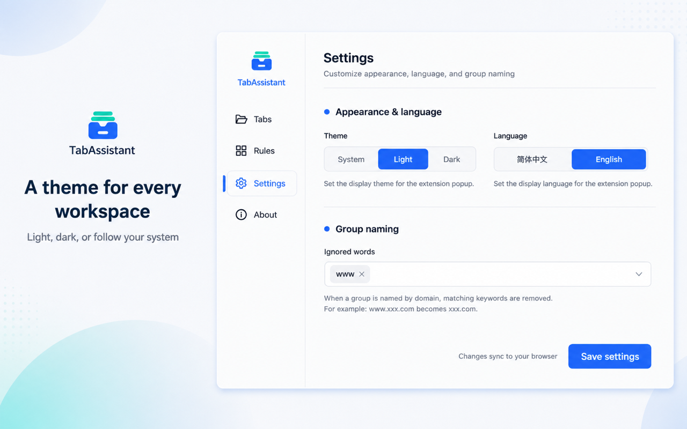

<p align="right">
  English · <a href="./README.zh-CN.md">简体中文</a>
</p>

<div align="center">
  
  <h1>TabAssistant</h1>
  <p>Bring browser tabs back into order</p>
  <p>
    Rule-based auto-grouping · Independent multi-window management · Runs locally
  </p>
  <p>
    <a href="https://chromewebstore.google.com/detail/obdaljfdjocbdmpofhncldmfppjeemda">Install for Chrome / Edge</a>
    ·
    <a href="https://github.com/woolson/tab-assistant/issues">Feedback</a>
    ·
    <a href="./LICENSE">MIT License</a>
  </p>
</div>


## Why TabAssistant?

As tabs pile up, finding pages, organizing groups, and switching between windows all become unnecessarily time-consuming.

TabAssistant organizes newly opened tabs according to your rules, automatically placing scattered pages into the right groups. From one interface, you can search, expand, collapse, close, or restore tabs while keeping every browser window independently organized.

Rule-based organization runs locally. Optional AI grouping sends tab titles, URLs, group information, and any enabled page excerpts/click context directly to your selected AI provider, which may charge for API usage. TabAssistant has no relay server. Rules and preferences are stored in browser extension storage and can use your browser's built-in sync capability.

## Features

- **Rule-based auto-grouping**: Match newly opened tabs by domain or regular expression.
- **Clear, flexible rule management**: Customize group names, colors, and matching patterns, then drag rules to change their priority.
- **Batch management for the current window**: Search tabs, expand or collapse all groups, close multiple tabs, and restore accidentally closed pages.
- **Independent multi-window organization**: Manage every window separately and keep tabs in their original browser window.
- **Automatic local-file grouping**: Place `file://` pages into a dedicated Local Files group.
- **Auto-close inactive tabs**: Optionally close web page tabs (http/https/file only) that have not been visited for a configurable amount of time (30 minutes by default; off by default). The countdown restarts every time you revisit a tab, and the tab you are viewing, pinned tabs, tabs playing audio, the last tab in a window, and browser built-in pages (such as the New Tab page) are never closed.
- **Personalized appearance**: Choose a light theme, dark theme, or follow your system setting.
- **Chinese and English UI**: Switch between Simplified Chinese and English.
- **Configuration migration**: Import and export grouping rules and extension preferences.

Decision logging is off by default. Enable **Settings → Logging → Record decision logs** to record AI grouping decisions and show the log page. Disabling it immediately stops recording and hides the page without affecting auto-grouping. Switch changes are saved immediately and persist after reopening. **Clear existing logs** also works while logging is off and does not change the switch. Logs stay on this device.

Use **About → Import rules and settings** to restore a JSON backup. Starting from the toolbar popup opens a persistent extension page; click Import there to choose the file and view the result. This avoids losing the import context when a [toolbar popup closes on losing focus](https://developer.chrome.com/docs/extensions/develop/ui/add-popup). Imports from the Side Panel stay in place. Success and failure messages remain visible on the import page.

Backups are checked for valid JSON, rule arrays, rule fields/regular expressions and setting types before storage changes. Legacy backups can omit newer fields: imported setting fields merge into the current settings, so omitted AI/logging/capture preferences are preserved. Rule-only and settings-only backups leave the other section unchanged. Only supported rule/setting keys are imported; API credentials, token statistics and other local extension state are not overwritten. Missing legacy rule IDs/priorities are normalized, UTF-8 BOM files are accepted, and unreadable or oversized files get a clear error. Success is shown only after the background confirms the configuration was applied; a reload failure explicitly reports that settings were saved but not applied.

**Quick search** opens a Raycast-style overlay in the center of the current web page, with a dimmed backdrop and no separate browser window. The default shortcut is **Command + Shift + K** on macOS and **Alt + Shift + K** on other platforms. A Quick search entry is available in the Side Panel header and under Settings. Under **Settings → Quick search**, the extension shows the actually assigned shortcut and links to the browser's [shortcut configuration](https://developer.chrome.com/docs/extensions/reference/api/commands); other extensions or browser shortcuts may prevent a default binding.

Search covers tabs in every accessible browser window and the current profile's bookmarks and browsing history, including bookmark folder paths and tab-group names. It supports Chinese/English text, URL text, non-contiguous characters and simple spelling mistakes. Matching and ranking run entirely on this device; queries and search data are not sent to AI services. The collected index is searched before displaying the best 80 matches, and filters can show All, Tabs, Bookmarks or History. Use **↑ / ↓** to select, **Enter** to focus an existing tab (expanding its group if needed) or open a bookmark/history result in a new tab in the originating normal browser window, and **Esc**, the shortcut again, or a click on the backdrop to close. Closing restores the page's previous focus. IME candidate selection does not activate results. The shortcut uses [activeTab](https://developer.chrome.com/docs/extensions/develop/concepts/activeTab) for temporary injection permission; it does not require permanent access to all sites. Browser settings pages, new-tab pages and other pages that block injection use the centered standalone window as a fallback. The overlay uses a closed shadow root and an extension-origin iframe, with per-tab session authorization so websites cannot read search results. Search windows are excluded from automatic grouping.

This feature uses the [bookmarks permission](https://developer.chrome.com/docs/extensions/reference/api/bookmarks) and [history permission](https://developer.chrome.com/docs/extensions/reference/api/history) to read search data and recheck the selected saved page before opening it. It does not edit bookmarks or delete history. Reload the updated unpacked extension and accept any browser permission prompt. If either source is unavailable, tab search remains usable and the window shows a source-specific permission notice.

History loads independently so it does not delay tab/bookmark results or input focus. The latest 10,000 distinct history pages form a local fuzzy-search index; typing a query also starts a debounced browser history lookup across all retained dates, adding up to 1,000 keyword matches so older pages can still be found. Counts reflect loaded candidates. Results from the two history lookups are merged by history ID, refreshed on visits/deletions, and sorted by last visit when no query is entered. Stale query responses are ignored, and opening rechecks the actual URL/history ID to handle deleted records.

The shortcut targets the tab supplied by the browser's command event. An existing standalone search window cannot intercept an invocation from a normal page. The overlay's readiness deadline starts after the page injection has finished, so a busy renderer does not consume the interface's loading budget. If the overlay cannot start, the standalone view explains whether the page is protected, site access was denied, injection failed, or the search interface did not finish loading.

The overlay and backdrop appear together only after the search interface has applied its saved theme. Initial documents and frame containers use a transparent background to avoid a dark placeholder flashing before a light theme. Theme loading runs independently of search-data collection, and reduced-motion preferences disable the short fade-in.

Search receives keyboard focus as soon as it appears. The input is focused after becoming visible, and the embedding frame sends a session-scoped focus notification after revealing the overlay so typing can begin immediately.

Under **Settings → Quick search → Search appearance**, choose **Classic** or **Frosted**. Frosted is the default. Liquid Glass is temporarily hidden; existing Liquid Glass preferences render as Frosted, and older JSON backups remain compatible. Frosted opacity and blur are tuned separately for the light and dark themes and are applied automatically; saved transparency and blur values in older backups do not affect them. The settings preview responds to the chosen material; click **Save settings** to persist it. Both appearances follow the light/dark theme, and classic mode preserves the solid appearance.

The in-page dialog performs background blur in the host page, with a transparent extension iframe above it so the actual page can show through the glass. Appearance settings are applied before the overlay is revealed and update if saved settings or the system theme change. High-contrast/reduced-transparency preferences increase the panel's opacity, and browsers without backdrop filtering use an opaque fallback. Standalone fallback windows use the same surface styling over a local color wash; they cannot blur other desktop windows. Appearance settings are included in JSON backup/restore, and legacy imports preserve them when unspecified.

Keyboard and mouse selection use a single background highlight that slides between results over 160 ms and adapts to each row's actual height. The highlight follows list scrolling and window resizing, while the Enter indicator reserves a fixed amount of space so selection does not rewrap URLs. New queries and filters place the highlight directly on the first result. Reduced-motion preferences disable highlight transitions.

Closing a visible overlay fades the dialog and backdrop out together over 160 ms, with a slight scale-down, before removing the overlay and restoring page focus. Rapid reopening cancels the previous cleanup so it cannot close the new search. Reduced-motion preferences skip the exit animation, and hidden or navigating pages clean up immediately.

Drag an edge or corner to resize the search overlay. Opposite edges move symmetrically so the overlay stays centered throughout the drag. The bottom-right grip indicates the resize control. Completed drags save the width and height in extension-local storage; the next opening restores those dimensions before the overlay appears. Cancelling a drag restores the previous size. Minimum dimensions are 360 × 280 pixels when space allows, and the overlay is constrained to the current viewport. Temporarily shrinking the browser window does not overwrite the preferred size. Standalone fallback windows also restore the preference, remember native resize operations, and recenter horizontally after the browser commits their new bounds.

Use **← / →** to cycle between All, Tabs, Bookmarks and History, keeping the query and selecting the first result in the new type. IME composition and modified arrow keys keep their normal editing behavior. With an empty query, tabs appear in descending order of the browser's last-accessed time across windows, followed by bookmarks and then recent history; typed queries use relevance ranking. Results show site icons through the browser's [favicon endpoint](https://developer.chrome.com/docs/extensions/how-to/ui/favicons), with a generic type icon while loading or on failure. This requires the `favicon` permission; no public favicon service is used.

## AI API setup

Open **Rules** and use the same segmented control as the language setting to choose **Custom mode** or **AI mode**. Custom mode shows your saved rules on a blue background; AI mode shows API settings on a purple background, with matching dark-theme colors. The selected mode is saved immediately without a success notification, and switching preserves your rules and API settings. In AI mode, select DeepSeek, OpenAI, Qwen, Claude or Gemini, enter your API key and save the AI configuration. Provider endpoints and default models are filled automatically. Choose a model from the main settings dropdown; a small note below explains its purpose and whether it is recommended for auto-grouping. Choose **Custom model** to enter another model ID. Updated defaults do not overwrite saved models. **Test connection** sends a small test prompt without browsing data; testing does not save the draft. Expand **Endpoint and timeout settings** to override endpoint defaults or select **Custom** to enter an OpenAI Chat Completions, Anthropic Messages or Gemini endpoint, model and timeout. HTTPS and loopback HTTP endpoints are supported. Non-streaming request timeouts remain configurable from 5 to 25 seconds (25 by default). HTTP redirects are rejected so credentials are not forwarded to another endpoint.

The OpenAI provider uses streaming Chat Completions with separate first-response and complete-result deadlines. The first response must arrive within the saved 5–25 second deadline, below the [background worker fetch deadline](https://developer.chrome.com/docs/extensions/develop/concepts/service-workers/lifecycle). A complete result can take up to 60 seconds by default, configurable up to 120 seconds under **Completion deadline**; old saved configurations receive this new default while retaining their first-response timeout, model and endpoint. A [bounded extension API heartbeat](https://developer.chrome.com/docs/extensions/develop/migrate/to-service-workers#keep_a_service_worker_alive_until_a_long-running_operation_is_finished) runs only while that request is active and stops on success, cancellation or failure. The outer grouping budget also allows time for page-content preparation. The [final streaming usage chunk](https://developers.openai.com/api/reference/resources/chat/subresources/completions/methods/create) is read before completion so token statistics still accumulate once per request. Truncated/incomplete streams never apply partial decisions. Providers that respond with regular JSON are still accepted. Requests are not automatically retried.

Invisible document-title prefixes are removed before title truncation and task-evidence validation. For example, a 70-character invisible watermark no longer leaves only ten visible characters in an 80-character prompt title. The same cleanup applies to candidate samples, content summaries and decision-log titles, while preserving joiners inside emoji and language text. The decision log distinguishes **AI response timed out**, **Group evidence not verified** and **Model chose no change**, including previously recorded entries whose placement result was simply kept/ungrouped. A successful provider call and an applied grouping decision are separate outcomes.

Full regrouping processes one tab at a time through the shared decision queue, so total time includes every page's preparation and API call. The connection test uses a minimal prompt and does not exercise this full workload. Content extraction has a hard 1.2-second limit that also covers a suspended renderer's pending `executeScript` call; missing content does not block the API request. Useful candidate summaries are cached only in memory for that run, invalidated on navigation/title/content changes and cleared when the run ends. Targets are always read fresh. Empty/loading summaries are not cached. The job stops after three consecutive processing failures, preserving existing groups and reporting partial progress instead of continuing to send a failing request for every remaining tab.

A streamed `finish_reason` marks completed generation. Once final usage is available, the client can finish without waiting for a missing `[DONE]` or transport close. Without usage, it waits at most one second for that final chunk; missing usage remains unknown. Streams without a completion marker still cannot apply partial answers. Decision logs include the actual configured provider/model, input character count (not estimated tokens), API duration and first-response duration, and distinguish a first-response timeout from a completion timeout. These metadata do not contain prompts, API keys or endpoints.

AI grouping uses tasks and intent across websites. Queries from common search engines are sent separately so long tracking URLs cannot hide the topic. If a successful model response declines to group an ungrouped search page, an explicit query can still create or reuse a narrowly named research task; the log identifies this search-topic decision. When a grouped page navigates, changes its title, or changes its captured text at the same URL, its task is reassessed against the current window: it can stay in its current group, join a more suitable group, or get a new task group. A shared task title can also be refined without moving tabs. Text changes require content capture and site access. Stable, unchanged summaries are deduplicated so DOM noise does not repeatedly call the API. Manual group names and explicit rules are preserved. Missing configuration or API errors leave new tabs ungrouped and keep existing tabs in their current group; there is no domain fallback in AI mode. Browser built-in models and model downloads are no longer used.

Joining a group requires task-specific evidence quoted from both the target page and the candidate group. Sharing a platform, domain, generic document portal or opener does not establish a shared task. Up to six group samples are supplied, with specific page titles ahead of generic portals. Unsupported joins keep the current grouping, including attempts to reuse an existing title through a create action. An ungrouped page is reconsidered when its real task title loads at the same URL; responses based on an older title are discarded. Decision logs show the model's brief reason and identify insufficient task evidence when logging is enabled.

In AI mode, **Regroup all tabs** reassesses grouped and ungrouped tabs in every window using the saved AI settings. A confirmation warns that processing all tabs may use many tokens and incur API charges. Pinned tabs and browser pages are skipped; existing rules and local-file grouping retain priority. Tabs are handled one at a time without first removing their groups, so API failures preserve the previous organization. Progress and skipped/failed counts are visible when reopening the popup or Side Panel; repeated clicks reuse the running job. If the worker restarts or configuration is reloaded, an interrupted job requires starting again with confirmation.

For workbenches with generic titles and opaque IDs, enable **Read page content and new-tab click context** and save the settings. Capture reads bounded visible text in components, tables, read-only documents and open Shadow DOM, plus page metadata and selected context such as an environment tab. Navigation, hidden content, form inputs, editable drafts and empty-state placeholders are excluded. Empty or metadata-only summaries briefly wait for dynamic content. Up to three ambiguous group pages contribute short summaries so matching can use task evidence on both sides. Ungrouped pages can be reassessed after body content loads without a title or URL change; unchanged content is deduplicated. Text remains in request memory and is not persisted by the extension.

In AI mode, manual assignments, removals and group renames teach local grouping preferences independently of decision logging. The latest choice for a page replaces its previous choice; repeated choices strengthen it. At most 100 examples are kept on this device, with page titles, sanitized URLs, chosen/rejected group names and counts, without storing page bodies. Automatic grouping, ordering, collapse changes, pinned/closed pages and credential-bearing URLs are excluded. Learning makes no separate AI call. Up to eight related examples accompany later grouping requests to the selected provider. One app-level example is only a clue; an app habit requires consistent choices on at least two distinct pages without conflicting choices. A remembered decision to leave a search ungrouped also prevents the local search-topic fallback from regrouping it. The AI settings show recent choices and **Clear grouping preferences**; clearing also drops pending learning and in-flight decisions using the old preferences.

The AI settings include **Token usage**, grouped by the provider and model configured when each request starts. Input and output tokens accumulate on this device across automatic grouping, full regrouping and connection tests, starting with this version; previous usage cannot be recovered. Switching providers/models preserves existing totals. Counts use API-reported usage only: `—` means no count was reported, while a reported zero is shown as `0`. Requests with missing or partial usage (including failures/timeouts) are identified separately; reported portions still count. One background writer serializes reports from popup, Side Panel and background requests to avoid losing concurrent updates. Only provider/model IDs, counters, timestamps and recent random request IDs are stored, without prompts, page content or credentials. This local record is separate from provider billing and does not sync or appear in configuration exports.

Token accounting follows the [OpenAI Chat Completions usage fields](https://developers.openai.com/api/reference/resources/chat), [Anthropic cache usage fields](https://platform.claude.com/docs/en/build-with-claude/prompt-caching), and [Gemini usage metadata](https://ai.google.dev/api/generate-content). OpenAI-compatible counts already include their cached/reasoning subsets. Anthropic input includes uncached, cache-creation and cache-read tokens. Gemini input includes cached tokens; output includes candidate and thought tokens. Missing counts are never inferred from totals.

Preset references: [DeepSeek](https://api-docs.deepseek.com/quick_start/agent_integrations/), [OpenAI](https://developers.openai.com/api/docs/models/gpt-6-luna), [Qwen](https://help.aliyun.com/zh/api-gateway/ai-gateway/user-guide/creating-services), [Claude](https://platform.claude.com/docs/en/models/overview), [Gemini](https://ai.google.dev/gemini-api/docs/models/gemini-2.5-flash-lite). Available models depend on your provider account; defaults can be overridden.

## Interface Preview

### Grouping Rules

Define automatic grouping rules with domains or regular expressions, then drag them to adjust matching priority.


### Rule Editor

Configure the name, group color, matching method, and matching content for each rule.


### Theme and Language

Choose light, dark, or system theme and switch the extension's display language.



## Installation

### Chrome / Edge

Install TabAssistant from the [Chrome Web Store](https://chromewebstore.google.com/detail/obdaljfdjocbdmpofhncldmfppjeemda). Microsoft Edge can also install extensions from the Chrome Web Store.

### Local Development Build

```bash
npm ci
npm run build
```

Open your browser's extension management page, enable Developer mode, choose **Load unpacked**, and select the project's `build` directory.

## Development

```bash
# Install dependencies
npm ci

# Start the local development server
npm start

# Create a production build
npm run build

# Build only the background script
npm run build:bg
```

TabAssistant is built with React, TypeScript, Ant Design, and Chrome Extension Manifest V3.

## Permissions and Privacy

TabAssistant requests only the permissions needed to organize browser tabs:

- `tabs`: Read and manage browser tabs.
- `tabGroups`: Create and manage tab groups.
- `storage`: Save rules, language, theme, and other preferences in browser extension storage.
- `alarms`: Periodically check for inactive tabs so the optional auto-close feature keeps working after the extension's background service worker is suspended.
- `webNavigation`: Detect which tab opened a new tab (so a tab opened from a grouped page can join the same group), including pages that use `rel="noopener"`. Only the relation between the two tabs is kept, in memory, for a few seconds.
- `scripting`: Register the optional click-source recorder described below. It does nothing unless you turn that feature on.

### Optional site access

Saving AI configuration or testing a connection requests access to the configured API host. Turning on **Read page content and new-tab click context** separately requests site access to collect page descriptions, headings, bounded prose and clicked-link context. Turning capture off stops collection and unregisters its content script; existing host permissions remain available for API calls. You can revoke permissions in the browser extension settings. Nothing is requested at install time.

Rule-based organization runs locally. When AI grouping is enabled, the selected provider receives tab titles, URLs, group information, and any enabled page excerpts/click context. API keys and endpoint settings stay in local extension storage, are not synced, and are excluded from exports. Rules and preferences are stored in browser extension storage and may sync between your devices through your browser's own synchronization mechanism.

## Related Documentation

- [Chrome Extension Manifest V3](https://developer.chrome.com/docs/extensions/mv3/manifest/)
- [Chrome Tabs API](https://developer.chrome.com/docs/extensions/reference/api/tabs)
- [Chrome Tab Groups API](https://developer.chrome.com/docs/extensions/reference/api/tabGroups)

## License

[MIT](./LICENSE)
