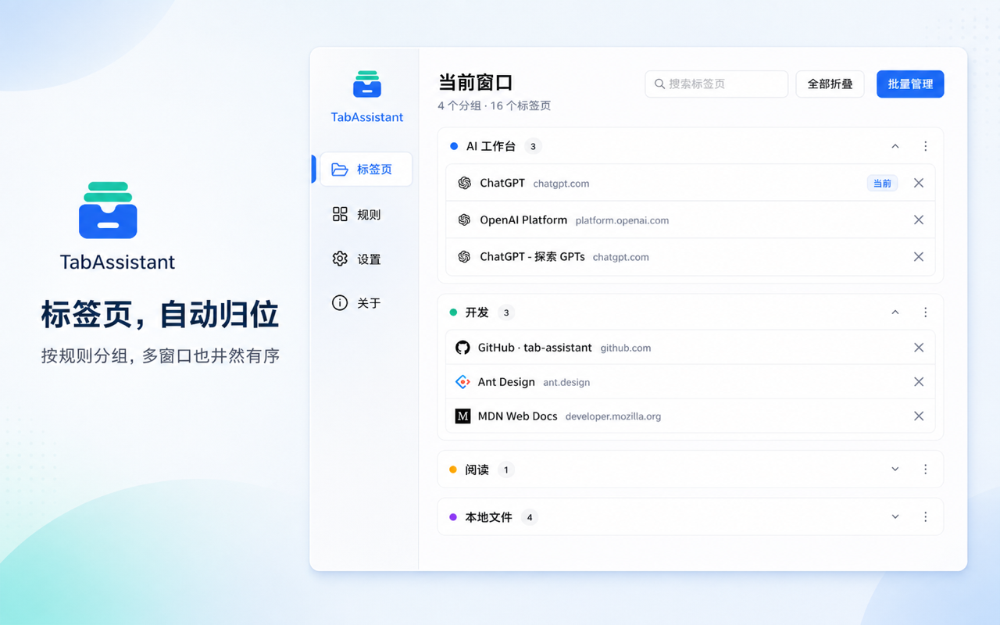
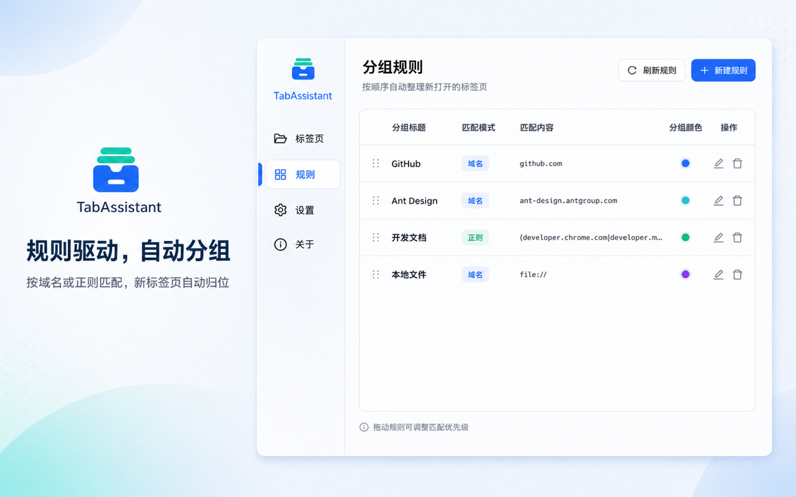
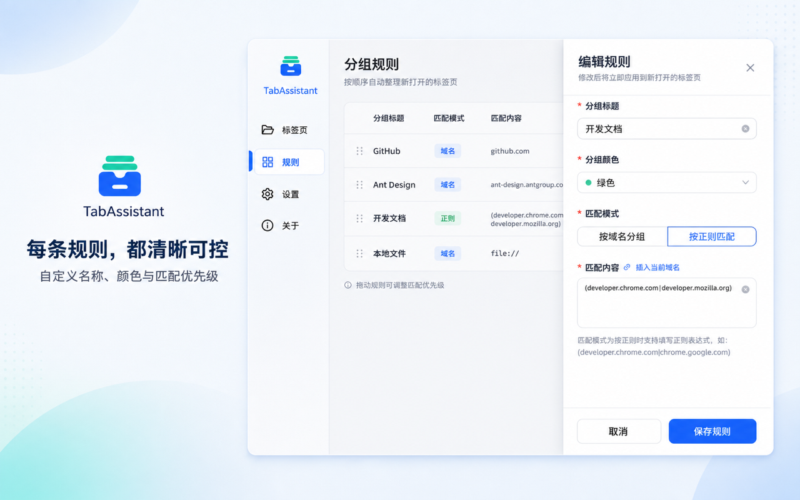
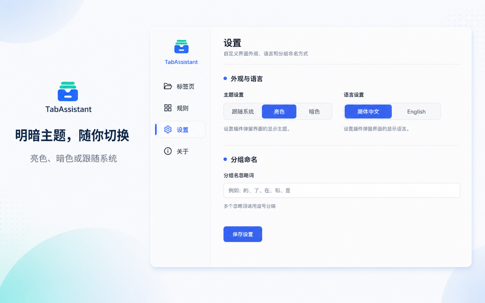

<p align="right">
  <a href="./README.md">English</a> · 简体中文
</p>

<div align="center">
  
  <h1>TabAssistant</h1>
  <p>让浏览器标签页自动回到秩序</p>
  <p>
    按规则自动分组 · 多窗口独立管理 · 本地运行
  </p>
  <p>
    <a href="https://chromewebstore.google.com/detail/obdaljfdjocbdmpofhncldmfppjeemda">Chrome / Edge 安装</a>
    ·
    <a href="https://github.com/woolson/tab-assistant/issues">问题反馈</a>
    ·
    <a href="./LICENSE">MIT License</a>
  </p>
</div>


## 为什么使用 TabAssistant

标签页一多，找页面、理分组、切窗口都很费时间。

TabAssistant 会按照你设置的规则整理新打开的标签页，让散乱页面自动进入对应分组。你可以在一个界面中搜索、展开、折叠、关闭或恢复标签页，同时让不同浏览器窗口保持各自的整理秩序。

规则分组在浏览器本地完成。可选的 AI 分组会将标签标题、网址、分组信息以及已开启采集的页面摘要、正文片段和点击来源直接发送给所选 AI 服务商，可能产生 API 费用；TabAssistant 不提供中转服务器。规则和设置保存在浏览器扩展存储中，可使用浏览器自身的同步能力。

## 功能亮点

- **规则驱动的自动分组**：支持按域名或正则表达式匹配新标签页。
- **清晰可控的规则管理**：自定义分组名称、颜色和匹配内容，通过拖拽调整优先级。
- **当前窗口批量管理**：搜索标签页，一键展开或折叠分组，批量关闭并恢复误关页面。
- **多窗口独立归位**：每个窗口分别管理，标签页保留在原来的浏览器窗口。
- **本地文件自动归类**：`file://` 页面可自动进入“本地文件”分组。
- **闲置标签页自动关闭**：可选开启，自动关闭超过设定时长未被访问的网页标签（默认关闭，时长默认 30 分钟，仅限 http/https/file 页面）。每次切换回标签页会重新计时；正在查看、固定、正在播放声音、窗口中最后一个标签页以及浏览器内置页面（如新标签页）不会被关闭。
- **个性化外观**：支持亮色、暗色和跟随系统三种主题。
- **中英文界面**：可在简体中文与 English 之间切换。
- **配置迁移**：支持导入、导出分组规则和插件设置。

日志默认关闭。在「设置 → 日志」中开启「记录决策日志」后，才记录 AI 分组决策并显示「日志」页面；关闭后立即停止记录、隐藏入口与页面，不影响自动分组。开关状态立即保存，重新打开后保持不变。「清除已有日志」在开关关闭时也可使用，清除不改变开关状态。日志仅保存在本机。

## AI API 配置

打开「规则」，使用与语言设置一致的分段选择组件切换「自定义模式」和「AI 模式」。自定义模式显示规则列表并使用浅蓝背景；AI 模式显示 API 配置并使用浅紫背景，暗色主题也有对应配色。模式切换立即保存，不弹出成功提示；已有规则和 API 配置会保留。在 AI 模式下选择 DeepSeek、OpenAI、通义千问、Claude 或 Gemini，填写 API Key 并保存 AI 配置。预置服务商自动填好接口地址与默认模型。模型在主配置区通过下拉选择，下方以小字说明用途和是否推荐用于自动分组；也可选择「自定义模型」填写服务商提供的模型 ID。已保存的模型不会被新默认值覆盖。「测试连接」仅发送简单测试提示，不发送浏览内容，也不会保存草稿。展开「接口与超时配置」可修改接口预设；选择「自定义」服务商可填写 OpenAI Chat Completions、Anthropic Messages 或 Gemini 格式的接口地址、模型与超时。支持 HTTPS 和本机 HTTP 地址；请求超时可设为 5–25 秒，默认 25 秒，以便在浏览器后台请求时限内完成或取消。拒绝 HTTP 跳转以避免将 Key 转发到其他接口。

AI 按任务和意图跨网站分组。常见搜索引擎的搜索词会单独传给模型，不受网址截断影响；模型成功响应但未选择分组时，明确的搜索主题仍可创建或复用任务组，例如「了解 S16 总决赛」，日志会注明根据搜索主题分组。组内页面跳转、标题变化或同一网址下采集的正文变化后，会重新判断任务：保留当前组、加入更合适的已有组，或新建任务组；仍属于共同任务时也可以更新组名。正文变化检测需要开启内容采集并授予网站权限，内容稳定后才判断，未变化的摘要不会重复调用 API。保留手动组名、近期手动移动和显式规则。配置缺失或请求失败时，新标签保持未分组，已分组标签保留当前组，不按域名兜底。不再使用浏览器内置模型，也无需下载模型。

## 界面预览

### 当前标签

查看当前窗口中的全部分组和标签页，快速搜索或批量整理。



### 分组规则

用域名或正则表达式定义自动分组规则，并通过拖拽调整匹配顺序。



### 规则编辑

为每条规则设置名称、分组颜色、匹配方式和匹配内容。



### 主题与语言

选择亮色、暗色或跟随系统主题，并切换插件界面语言。



## 安装

### Chrome / Edge

从 [Chrome Web Store](https://chromewebstore.google.com/detail/obdaljfdjocbdmpofhncldmfppjeemda) 安装。Microsoft Edge 同样支持安装 Chrome 扩展。

### 本地开发版本

```bash
npm ci
npm run build
```

然后打开浏览器的扩展管理页面，启用“开发者模式”，选择“加载已解压的扩展”，并加载项目中的 `build` 目录。

## 本地开发

```bash
# 安装依赖
npm ci

# 启动本地开发服务
npm start

# 生成生产构建
npm run build

# 仅构建后台脚本
npm run build:bg
```

项目基于 React、TypeScript、Ant Design 和 Chrome Extension Manifest V3。

## 权限与隐私

TabAssistant 只申请实现标签分组所需的权限：

- `tabs`：读取和管理浏览器标签页。
- `tabGroups`：创建和管理标签页分组。
- `storage`：在浏览器中保存规则、语言、主题等设置。
- `alarms`：周期性检查闲置标签页，确保可选的自动关闭功能在扩展后台 Service Worker 被挂起后仍然生效。
- `webNavigation`：识别新标签页是被哪个标签页打开的（例如从已分组的页面点开的链接可以留在同一分组），包括页面使用 `rel="noopener"` 的情况。只在本机内存中短暂保留两个标签页之间的关联关系。
- `scripting`：用于注册下方介绍的可选点击来源记录脚本。不开这个功能时它不会做任何事。

### 可选的网站访问权限

保存 AI 配置或测试连接时，申请所配置 API 接口的网站访问权限。另行开启「读取页面内容与新标签页的点击来源」时，会申请网站访问权限，用来提取页面描述、标题、有限正文及点击来源。关闭采集后会停止读取并注销内容脚本；为避免中断 API 调用，不自动撤销已有主机权限。可在浏览器扩展管理页撤销授权，安装时不申请网站权限。

规则分组在本机运行；开启 AI 后，相关标签信息及已开启采集的页面摘要、正文片段和点击来源会发送给所选 AI 服务商。API Key、接口地址与模型配置仅保存在本机，不随浏览器同步，也不包含在导出文件中。规则和设置保存在浏览器扩展存储中，并可能通过浏览器自身的同步机制在你的设备之间同步。

## 相关文档

- [Chrome Extension Manifest V3](https://developer.chrome.com/docs/extensions/mv3/manifest/)
- [Chrome Tabs API](https://developer.chrome.com/docs/extensions/reference/api/tabs)
- [Chrome Tab Groups API](https://developer.chrome.com/docs/extensions/reference/api/tabGroups)

## License

[MIT](./LICENSE)
